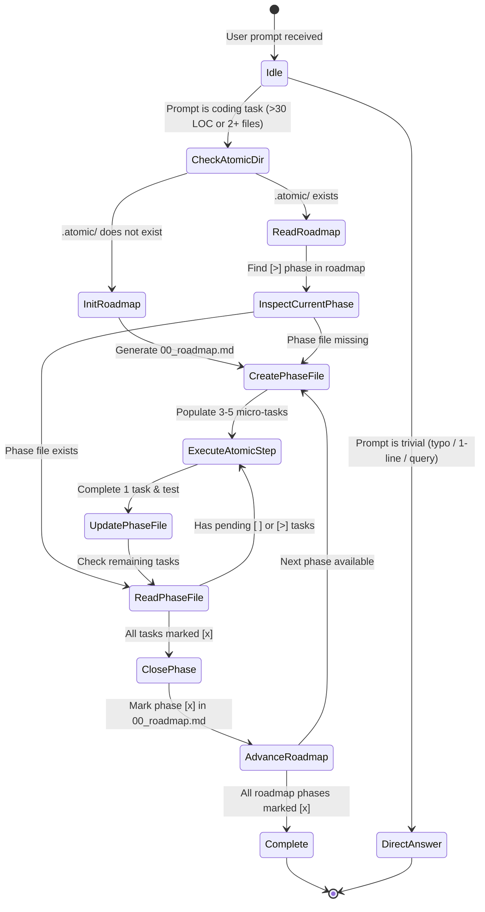

# State Machine & Decision Heuristics

This reference specifies the exact deterministic state transitions for the `atomic-coding` workflow.

---

## State Diagram

---

## Deterministic Rules Summary

1. **Idle $\rightarrow$ CheckAtomicDir**:
   - `len(lines_to_modify) > 30` OR `affected_files >= 2` OR `user_prompt contains ["refactor", "build", "implement feature"]`

2. **Phase Boundary Rules**:
   - Max tasks per phase file: 5 tasks.
   - Max lines of code generated per turn: 40 lines.
   - Never write code for Phase $N+1$ while Phase $N$ has incomplete tasks.

3. **Disk Persistence**:
   - State lives strictly on disk (`.atomic/`). Chat history can be wiped or compacted at any time without losing position.
